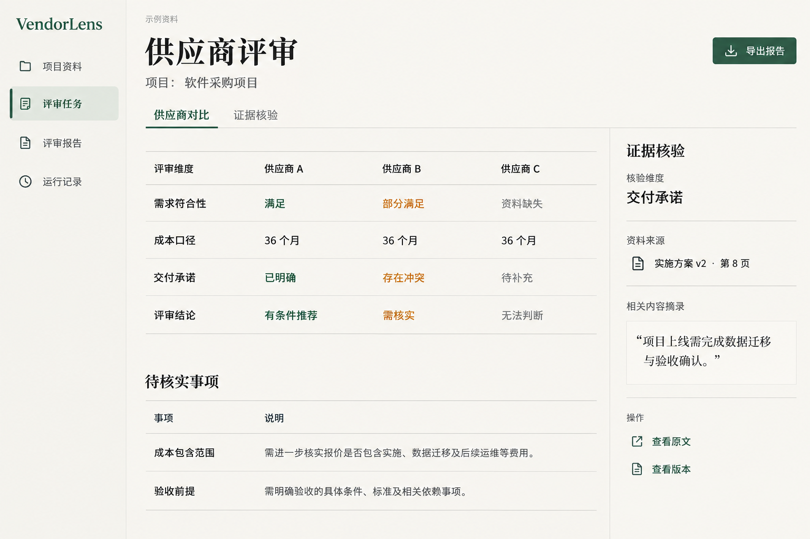

# VendorLens 前端工作台设计

日期：2026-10-02  
视觉方向：文档审阅风，采用已选定的第二张概念图。  
阶段：首版工作台已实现；桌面、手机与隔离后端接口验收已完成。

## 1. 视觉系统

界面采用米白底、墨色文字和深绿强调色。主体用横向分隔线组织内容，表格、列表与原文区域保持开放布局。大型标题使用宋体气质，业务正文与控件使用清晰的无衬线字体。

以下为从概念图提取的初始实现值，浏览器验收时对照原图校准：

| 项目 | 取值 |
| --- | --- |
| 页面底色 | `#F7F5EF` |
| 正文 | `#202724` |
| 次要文字 | `#6B706C` |
| 强调色 | `#315D4B` |
| 分隔线 | `#D8DAD3` |
| 需核实 | `#A46B20`，同时显示文字说明 |
| 标题字体 | Noto Serif SC / 宋体 / serif |
| 正文与控件 | Noto Sans SC / PingFang SC / Microsoft YaHei / sans-serif |
| 正文大小 | 15–16px，行高 1.6 |
| 控件圆角 | 4–6px |
| 间距单位 | 4、8、12、16、24、32、48px |

标题、导航、表头、正文、来源标注各有稳定层级。供应商状态同时用文字和颜色表达。图中的“示例资料”只用于演示模式，真实项目显示实际项目名称与来源。

## 2. 页面结构

桌面沿用概念图的三列结构：左侧项目导航，中间评审内容，右侧证据核验。导航提供项目资料、评审任务、评审报告、运行记录四个入口。项目切换在导航区完成，不增加独立仪表盘首页。

资料列表与任务列表不常驻证据栏；只有选中引用时打开。窄屏将证据区改为可关闭的抽屉，供应商表格允许横向滚动，保留行标题。键盘操作能进入引用、打开抽屉并通过 Escape 关闭，关闭后焦点回到原控件。

## 3. 项目资料

显示项目公共资料与供应商资料，列出文件名、供应商、格式、版本、解析/索引状态和上传时间。支持创建供应商、上传资料、查看版本、下载原文件及显式重试索引。公共资料和供应商资料归属在上传前选择。

查看版本时显示页码、段落、行区间或工作表/单元格定位。空文本 PDF 显示需要 OCR 的原因；索引失败显示可重试状态。当前报告的引用始终打开该报告固定的版本。

## 4. 评审任务

创建表单包含目标、参与供应商、行业、币种和比较周期，并可关联评审会话。评审配置在提交前展示；提交后显示排队与工作流事件，通过 SSE 续读更新。

运行中显示供应商与领域状态，失败、返工和降级都有明确文本。终态后进入报告。请求返回入队失败时保留 task_id，提供查询与重试入口，避免用户重复创建相同任务。

会话作为任务内的评审讨论区，不独立包装成自由聊天产品。用户可保存补充意见，再创建关联会话的评审任务。偏好设置提供比较周期、币种、报告详略和关注领域；保存操作明确由用户发起。

## 5. 评审报告

以概念图中的供应商比较表为主，展示需求符合性、可比成本、交付承诺、推荐条件与资料缺口。展开供应商后查看三个领域的详细结果和原文引用。排序与推荐使用后端结果，前端不重新计算业务评分。

右侧证据区展示关联领域、来源文件与版本、定位、连续原文、父块上下文，以及查看来源和下载原文件入口。成本详情分别展示基础 TCO、比较周期、已验证费用与可选费用，保留缺失和冲突说明。

概念图中的“导出报告”设计为前端导出已获取的报告 JSON，并提供打印样式用于浏览器另存为 PDF。DOCX 和服务器生成 PDF 尚无对应接口，不作为首版已有能力展示。概念图未展示的核验备注编辑不加入首版。

## 6. 运行记录

展示任务事件、Trace 父子时间线、请求耗时、完整 usage 的 Token 和估算费用。未知数据用“未提供”表达，不填零。路由详情展示候选评分、选择端点、冷却和探测状态；这里只显示安全运行信息。

Skills 列表与重载放在运行设置中。重载后显示有效版本和内容哈希；失败明确提示上一版仍有效。运行中的任务继续使用冻结规则。评测目前保留 CLI 产物，不新增缺少服务接口的交互评测页面。

## 7. API 对接

| 页面/功能 | 现有接口 |
| --- | --- |
| 项目、供应商、需求、配置 | `/projects` 及项目下管理接口 |
| 上传、版本、来源、下载、索引 | 项目下 documents / versions 接口 |
| 提交与任务列表 | `POST /projects/{project_id}/tasks`、`GET /projects/{project_id}/tasks` |
| 状态、报告、事件、重试 | `/tasks/{task_id}`、其 report / assessments / events / retry 接口 |
| 会话与偏好 | 项目下 sessions、messages、context、preferences 接口 |
| Trace 与路由 | `/tasks/{task_id}/trace`、`/tasks/{task_id}/routing`、`/routing/health` |
| Skills | `GET /skills`、`POST /skills/reload` |

前端统一处理加载、空数据、校验错误、权限错误、依赖不可用和报告尚未生成。演示数据采用独立模式，不将请求失败替换成演示结果。启用共享 Bearer Key 时，通过代理或支持 Header 的请求与 SSE 流读取方式传递凭据，不放到 URL 查询参数。

## 8. 实施与验收

沿用项目设计中已规划的 `apps/web`、Next.js、TypeScript、Tailwind CSS 与 shadcn/ui，组件样式按概念图调整。应用壳、资料管理、任务、报告、证据抽屉和运行记录分别组织，API 客户端与事件续读独立封装。

先实现评审报告与证据核验的主屏，校准视觉系统；再补资料上传、任务创建和实时进度，最后接入会话设置与运行记录。核心验收流程为上传资料 → 创建任务 → 续读进度 → 查看报告 → 回查固定版本原文。

对照已选概念图检查桌面截图，并验证窄屏、键盘焦点、长文件名、长引用、多供应商、空状态和失败状态。接口联调前需要更新运行服务的数据库迁移及进程，使新增运行接口可用。

实现与截图对照见[前端验收记录](2026-10-03-frontend-verification.md)。
